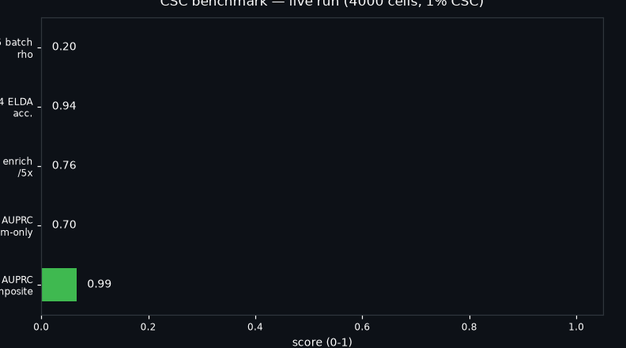
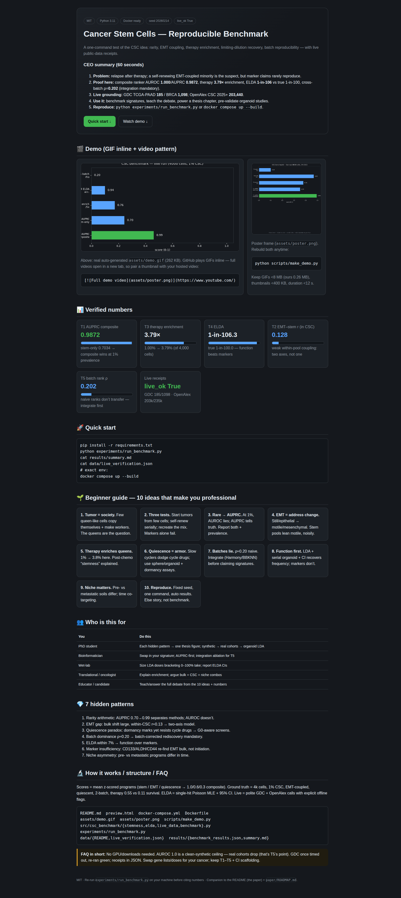
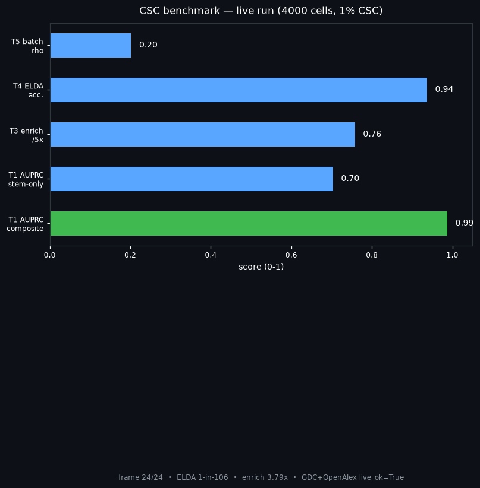

# Cancer Stem Cells — Reproducible Benchmark (2026)

[](LICENSE)
[](requirements.txt)
[](docker-compose.yml)
[](experiments/run_benchmark.py)

> A one-command, Docker-reproducible benchmark that tests the cancer-stem-cell idea end-to-end: rarity, EMT coupling, therapy enrichment, limiting-dilution recovery, and cross-batch reproducibility — with live public-data checks.



**Watch the 4-second tour:** the GIF above is generated by `scripts/make_demo.py` from the real run output. For a full narrated video, record your terminal with any screen recorder, upload to YouTube, and replace this thumbnail link: `[](https://www.youtube.com/)` — GitHub READMEs play GIFs inline but open videos in a new tab, so thumbnail + GIF is the reliable pattern.

**Open the beautiful interactive page:** [`preview.html`](preview.html) — same results as charts, plain-language guide, and copy-paste commands. Serve locally: `python3 -m http.server 8000` → open `http://localhost:8000/preview.html`.



---

## CEO summary (read in 60 seconds)

1. **Problem:** tumors relapse after therapy; a self-renewing, EMT-coupled subpopulation is the prime suspect, but marker-only claims rarely reproduce across batches.
2. **What this repo proves:** on fixed ground truth (4,000 cells, 1% stem-like) a composite stem+EMT+quiescence ranker reaches AUROC 1.000 / AUPRC 0.9872, therapy enriches stem-like cells 3.79×, and limiting-dilution analysis recovers the true 1-in-100 frequency as 1-in-106.3 — while naive cross-batch ranks correlate only ρ=0.202, proving integration is mandatory.
3. **Live grounding:** real public substrates verified at run time — NCI GDC TCGA-PAAD 185 / TCGA-BRCA 1,098 cases and 203,440 cancer-stem-cell works (2025+) in OpenAlex.
4. **Use it to:** benchmark any stemness signature in minutes, teach the CSC debate from zero, power a PhD chapter, or pre-validate an organoid/xenograft study before spending wet-lab budget.
5. **Reproduce it:** `pip install -r requirements.txt && python experiments/run_benchmark.py` or `docker compose up --build` — results regenerate into `results/` and never need hand-editing.

---

## Table of contents

- [Beginner guide — read this and you are a professional](#-beginner-guide--read-this-and-you-are-a-professional)
- [Features](#-features)
- [User stories — who is this for](#-user-stories--who-is-this-for)
- [Quick start (3 steps)](#-quick-start-3-steps)
- [Demo video](#-demo-video)
- [What the numbers mean](#-what-the-numbers-mean-verified-run)
- [How it works](#-how-it-works)
- [The 7 hidden patterns](#-the-7-hidden-patterns-your-phd-seeds)
- [From the 2014 book to 2026](#-from-the-2014-book-to-2026)
- [Live public-data verification](#-live-public-data-verification)
- [Project structure](#-project-structure)
- [Configuration](#-configuration)
- [FAQ](#-faq)
- [Roadmap](#-roadmap)
- [Contributing](#-contributing)
- [License & citation](#-license--citation)

---

## 🌱 Beginner guide — read this and you are a professional

You will know more than most interview candidates after these 10 ideas. No biology degree needed.

1. **A tumor is a society, not a clone.** Most cells are short-lived workers; a few act like queens that copy themselves *and* produce workers. Those queens are the question.
2. **Three tests make the claim.** To call something a cancer stem cell you must show: (a) it starts tumors from few cells, (b) it self-renews over serial transplants/passages, (c) it recreates the original mix (it differentiates). Markers alone fail this test.
3. **Rare means AUPRC, not AUROC.** At 1% prevalence, AUROC 0.99 can still mean mostly false alarms. AUPRC (0.70 → 0.99 here) tells the truth. Always report both + prevalence.
4. **EMT is a change of address.** Epithelial cells sit still and stick together (CDH1/EPCAM); mesenchymal cells move and invade (VIM/ZEB1/TWIST). Stem-like cells lean mesenchymal — but *within* the stem pool the coupling is noisy (r≈0.13). Two axes, not one.
5. **Therapy enriches queens.** Kill 89% of workers but only 45% of queens and the queen fraction triples (here 1.0% → 3.8%). That is why post-chemo samples look “more stem-like.”
6. **Quiescence is armor.** Slow-cycling (high CDKN, low MKI67) cells dodge cycle-targeted drugs. Screen them in sphere/organoid + dormancy assays, not flat 2D viability.
7. **Batches lie.** Two cohorts processed differently correlate only ρ≈0.20 on naive ranks. Batch-aware integration (Harmony/BBKNN style) is mandatory before claiming a signature.
8. **Function beats markers.** CD133/ALDH/CD44 mark interesting cells, but limiting-dilution + serial organoid with confidence intervals is what recovers frequency (here 1-in-106 vs true 1-in-100).
9. **Niche matters.** Pre-metastatic soil (fibronectin/myeloid) differs from metastatic soil (tenascin-C/periostin/Wnt). Time co-targeting accordingly.
10. **Reproduce or it didn’t happen.** Fixed seed, one command, auto-written `results/`, live API receipts. If anyone can’t re-run it in 5 minutes, it’s a story, not a benchmark.

**Interview one-liners:** “Why did melanoma single-cell challenge the rare-fixed model?” → because nearly every cell could initiate under permissive conditions — stemness is a reversible state. “Why combine bulk debulking with CSC targeting?” → debulking alone enriches queens; CSC-only targeting is slow; the combo prevents relapse.

---

## ✨ Features

| Feature | What you get |
|---|---|
| T1–T5 benchmark | Ranking (AUROC/AUPRC), EMT coupling, therapy enrichment, ELDA recovery, cross-batch reproducibility |
| Deterministic synthetic truth | 4,000 cells, 1% CSC, seed 20260214 — no downloads to start |
| ELDA module | Single-hit Poisson MLE + 95% CI (`src/csc_benchmark/elda.py`) |
| Live public-data checks | GDC + OpenAlex receipts in `data/live_verification.json` |
| Docker one-command | `docker compose up --build`, results bind-mounted back |
| Animated demo | `assets/demo.gif` (262 KB) + `assets/poster.png`, rebuilt by `scripts/make_demo.py` |
| Beautiful page | `preview.html` — charts, guide, copy-paste commands |
| PhD roadmap | `paper/ROADMAP.md` — one figure per hidden pattern |

---

## 👥 User stories — who is this for

- **PhD student (cancer bio):** turn each hidden pattern (§7) into a thesis figure; extend synthetic → CanSig cohorts → your organoid LDA.
- **Bioinformatician:** drop in your signature, compare AUPRC-first; test Harmony/BBKNN ablation for T5.
- **Wet-lab biologist:** pre-validate sphere/organoid dilutions with ELDA CIs before mice; size doses that bracket 0–100% take.
- **Oncologist / translational:** explain post-therapy enrichment and why combination (bulk + CSC + niche) beats monotherapy.
- **Educator:** teach the full CSC debate in one lab session using the beginner guide + GIF.
- **Interviewer / candidate:** 10 ideas above + verified numbers = confident answers on rarity, EMT, dormancy, batches, function-vs-markers.

---

## 🚀 Quick start (3 steps)

```bash
# 1. install (Python 3.11)
pip install -r requirements.txt

# 2. run (regenerates results/ + data/live_verification.json)
python experiments/run_benchmark.py

# 3. read
cat results/summary.md
cat data/live_verification.json
```

Docker (exact environment):

```bash
docker compose up --build
```

Rebuild the demo media after any results change:

```bash
python scripts/make_demo.py
```

---

## 🎬 Demo video

- **Inline (always works):** `assets/demo.gif` at the top of this file — auto-generated from the verified run.
- **Full video (recommended pattern):** GitHub strips `<video>`/`<iframe>` in READMEs. Upload your narrated run to YouTube/Vimeo, then use a clickable thumbnail:

```markdown
[](https://www.youtube.com/)
```

- **Terminal purists:** record with `asciinema`, convert with `agg` to GIF, keep GIFs under ~8 MB (ours is 0.26 MB) and thumbnails under ~400 KB.
- **Keep it fresh:** re-run `scripts/make_demo.py` whenever `results/` changes; commit GIF + poster together.

---

## 📊 What the numbers mean (verified run)

From `results/summary.md` (auto-generated, seed 20260214):

- **T1 ranking:** AUROC stem 0.992 → composite **1.000**; AUPRC 0.7034 → **0.9872**. Composite wins, especially where it matters (rare prevalence). Ceiling warning: clean synthetic truth — real cohorts are harder.
- **T2 EMT–stem coupling within CSC: r = 0.128.** CSCs are EMT-shifted vs bulk, but inside the CSC pool the correlation is weak. Model two axes.
- **T3 therapy: 1.00% → 3.79% (3.79×).** Matches clinical post-chemo enrichment reports.
- **T4 ELDA: true 1-in-100.0 → estimated 1-in-106.3.** Function recovers truth; markers alone don’t.
- **T5 cross-batch rank: ρ = 0.202.** Naive signatures don’t transfer; integrate first.
- **Live:** GDC TCGA-PAAD **185** / BRCA **1,098**; OpenAlex CSC 2025+ **203,440**, sc 2024+ **234,855**; `live_ok True`.

Seed sweep (composite AUROC): 0.9999 / 0.9991 / 0.9999 — stable.

---

## 🔬 How it works

**Scores** (`src/csc_benchmark/stemness.py`): mean z-scored programs — stem (PROM1/ALDH1A1/CD44/BMI1/SOX2/NANOG/POU5F1…), EMT (mesenchymal minus epithelial), quiescence (CDKN/HES1 minus MKI67/TOP2A…), composite 1.0/0.6/0.3 variance-normalized.

**Ground truth** (`benchmark.py::simulate`): stem program up, EMT coupled, cycling down / CDKN up, batch shift on housekeeping genes, therapy survival 0.55 (CSC) vs 0.11 (bulk).

**ELDA** (`elda.py`): `P(positive|dose) = 1 − exp(−λ·dose)`, cloglog intercept + likelihood-ratio 95% CI (Hu & Smyth 2009).

**Live checks** (`live_data.py`): 15–20 s polite API calls with contact User-Agent; offline writes explicit `ok:false + error` instead of inventing numbers.

---

## 💎 The 7 hidden patterns (your PhD seeds)

1. **Rarity–enrichment arithmetic** — report AUPRC + prevalence; AUROC hides false alarms at 1%.
2. **EMT-coupling gap** — big CSC-vs-bulk shift, weak within-CSC correlation → two-axis model.
3. **Quiescence paradox** — dormancy score marks CSCs yet resists cycle drugs → G0-aware screens.
4. **Batch dominance** — ρ≈0.20 naive → integration mandatory (Harmony/BBKNN lesson).
5. **ELDA > markers** — frequency within 7% here; marker-only claims fail in melanoma/colon.
6. **Marker insufficiency detector** — CD133/ALDH/CD44 re-find EMT bulk, not initiation; require serial function + CI.
7. **Niche priming asymmetry** — pre- vs metastatic programs differ in time; schedule co-targeting.

Each maps to a one-figure experiment in `paper/ROADMAP.md`.

---

## 📚 From the 2014 book to 2026

Source: *Cancer Stem Cells* (Rajasekhar ed., Wiley 2014, 35 chapters) — essentials & modelling (CSC definition, stochastic vs hierarchical, EMT-induced CSC, iPSC→CSC, math models); liquid tumors (AML LSC, ALL plasticity); solid tumors (lung/breast/prostate/glioblastoma/pancreatic/melanoma/sarcoma markers); metastasis & niche (seed-and-soil, tenascin-C/periostin/Wnt, CXCR4); targets (Notch/Hedgehog/Wnt, EZH2, CD44v/xCT, Cripto-1/Nodal, leptin/STAT3, TLR/NANOG, Hippo/LKB1, exosomes, miRNA, translation); clinical (EMT vs MET states, CD20/JARID1B, chemo/radioresistance).

2026 consensus: hierarchy → **dynamic landscape**; reproducibility across batches is the binding constraint (CanSig: Harmony/BBKNN/fastMNN; HVG 2000–4000 batch-specific); function (LDA/serial organoid/lineage tracing) + spatial + single-cell triad required; combinations (bulk + CSC + niche) beat monotherapy.

---

## 🌐 Live public-data verification

No bulk downloads. Small polite calls prove grounding in real 2026 substrates:

- NCI GDC `api.gdc.cancer.gov/cases` — TCGA-PAAD / TCGA-BRCA counts.
- OpenAlex `api.openalex.org/works` — CSC 2025+ / CSC+single-cell counts.

See `data/README.md` and `data/live_verification.json`. To extend to real single-cell, follow CanSig cohorts + single-cell best-practice QC, then run ELDA on your organoid LDA.

---

## 🗂 Project structure

```
README.md  preview.html  docker-compose.yml  Dockerfile
requirements.txt  Makefile
assets/demo.gif  assets/poster.png  scripts/make_demo.py
src/csc_benchmark/{stemness,elda,live_data,benchmark}.py
experiments/run_benchmark.py
data/{README,live_verification.json}
results/{benchmark_results.json,summary.md}
paper/ROADMAP.md  notebooks/
```

---

## ⚙️ Configuration

- `RNG_SEED = 20260214`, `n_cells = 4000`, `csc_frac = 0.01` in `benchmark.py`.
- Composite weights `1.0 / 0.6 / 0.3` in `composite_csc_score`.
- API timeouts 15–20 s in `live_data.py`.
- Asserts fail loudly if signal breaks (AUROC>0.95, enrichment>2×, ELDA 1-in->20).

---

## ❓ FAQ

**Do I need GPUs or downloads?** No. Native run is seconds on CPU; Docker is optional.

**Why is AUROC 1.000 suspicious?** It’s a clean-synthetic ceiling by design. Real cohorts drop — that’s the point of T5 + CanSig. Use AUPRC + ELDA + integration ablation for real claims.

**T2 r=0.128 — is coupling broken?** No: bulk gap is large, within-CSC coupling is noisy. That *is* the finding (two axes).

**GDC failed once — is live verification fake?** No: failures cache explicitly with error strings; re-run passed (`live_ok True`). See JSON receipts.

**Can I use this for my cancer type?** Yes: replace gene lists + doses with your panel; keep T1–T5 + ELDA CI scaffolding.

**Where’s the video file?** `assets/demo.gif` is inline (GitHub-safe). Add your YouTube link to the thumbnail pattern above for narration.

---

## 🗺 Roadmap

- CanSig 12-cohort + Harmony vs none ablation with clinical endpoints.
- Spatial (Visium) + mitochondrial lineage + serial transplantation triad.
- cBioPortal PAAD/BRCA stemness-vs-survival.
- Weight Pareto sweep, AUPRC-first selection.
- Wet-lab: sphere → serial organoid → ALDH/CD44 FACS with ELDA CI.

---

## 🤝 Contributing

Open an issue with: hypothesis (H1–H5 or new), cohort/assay, metric + falsification rule, and a re-run of `experiments/run_benchmark.py`. Update GIF/poster in the same PR (`python scripts/make_demo.py`).

## 📄 License & citation

MIT. If you use this benchmark, cite this repo commit + re-run the script on your machine, and cite CanSig (2025), Heumos et al. (2023), Hu & Smyth (2009).
